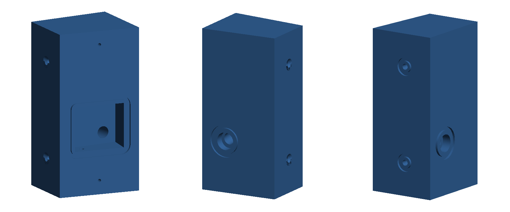
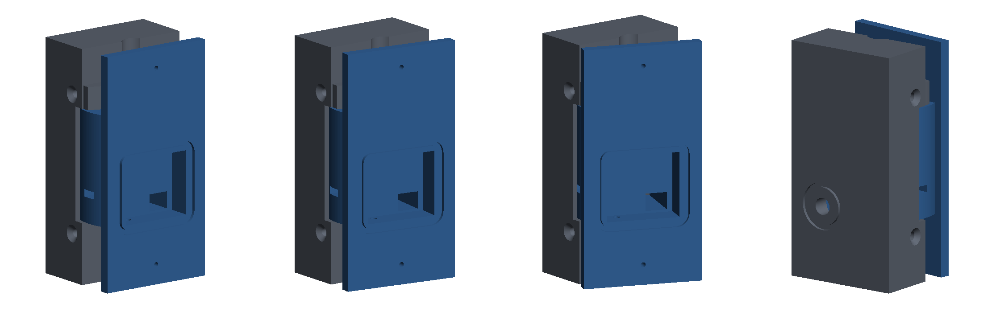

# Ring camera wedge

A 3D model of an angled mounting block for a Ring camera, built from the hand sketch in `Scan_20261101.png`. A Python script generates an STL file that you can import into Tinkercad.

For an overview, watch the [explainer video on YouTube](https://www.youtube.com/watch?v=u9r90f_Vszs), which has a computer-generated voice. It was published before a fix to the mounting screw countersinks in `ring_camera_wedge.stl`, so it shows the older file, with 8,682 triangles rather than the current 8,424. The fix removed stray geometry and didn't change the part's dimensions.

The below is the non-voiced over video...


https://github.com/user-attachments/assets/75be6c1d-c91d-4841-a23d-3686b114d44e




## Files

| File | Purpose |
|---|---|
| `ring_camera_wedge.stl` | The model, in millimetres |
| `ring_camera_wedge.py` | Generates the STL; all dimensions are constants at the top |
| `ring_camera_wedge_preview.png` | Picture of the default 8° model; the script does not update it |
| `requirements.txt` | Python dependencies |
| `.devcontainer/` | VS Code dev container configuration |
| `Scan_20261101.png` | The original sketch |
| `ring_camera_wedge_adjustable.py` | Generates the adjustable version |
| `ring_camera_wedge_adjustable_base.stl` | Adjustable version: base, ready to print |
| `ring_camera_wedge_adjustable_head.stl` | Adjustable version: head, ready to print |
| `ring_camera_wedge_adjustable_assembly.stl` | Adjustable version: both parts together at 8°, for viewing only |
| `ring_camera_wedge_adjustable_preview.png` | Picture of the adjustable version at 0°, 8° and 20°, and from behind at 8°; the script does not update it |
| `video/` | Generates the explainer video of this repo; see [video/README.md](video/README.md) |

## Weather sealing

Both versions are designed to keep water and dust out of the electrical pocket, but only if you print and assemble them as described here. A plain print leaks through its layers, and the seals below are separate parts you fit yourself. None of this has been tested, so it has no IP rating. Check the pocket after the first few heavy rains.

| | Fixed wedge | Adjustable version |
|---|---|---|
| **Pocket** | Sealed | Sealed |
| **Rest of the part** | One solid block | Open swivel joint that gets wet and dusty, then drains |
| **Best for** | Permanent outdoor use | Finding the angle, or sheltered locations |

The swivel has to move, so it can't be sealed. Grit in its teeth can also stop them meshing. For a permanent outdoor mount, find the angle with the adjustable version and then print the fixed wedge.

### What the model includes

- **Camera face:** a groove around the pocket for a gasket that the camera presses against.
- **Cable hole:** an O-ring groove around it on the back face. On the fixed wedge, the hole also rises 5° towards the pocket, so water runs back out, and has a 12 mm recess at the back for putty.
- **Mounting screws:** an O-ring groove around each hole where it meets the mounting surface.
- **Weep hole:** a 3 mm hole in the pocket floor that lets out condensation and any water that gets past the seals. It's the one opening in the sealed pocket, and it faces down to limit dust. Don't plug it, or water that gets in can't escape. If insects or dust are a problem, push a small piece of stainless mesh into it.
- **Adjustable version only:** the upper cheek is now a hood over the swivel, and two 4 mm drains in the lower cheek stop water sitting around the teeth.

### Parts to buy

These are in addition to the screws for your version.

| Quantity | Part | Used for |
|---|---|---|
| About 150 mm | 2 mm soft silicone cord, or closed-cell foam cord | Camera face gasket |
| 1 | 18 × 2 mm O-ring | Cable hole, back face |
| 2 | 8 × 2 mm O-ring | Mounting screws |
| 1 tube | Neutral-cure outdoor silicone | Screw heads, camera holes, surface joint. Avoid acetic-cure silicone (the kind that smells of vinegar), which can corrode electronics |
| 1 pack | Non-hardening sealing putty (duct seal) | Around the cable |

Use stainless steel for all screws, nuts and washers. On the adjustable version, use bonded sealing washers under the clamp and pivot screw heads instead of plain washers.

### Print for sealing

- **Material:** ASA is the best choice outdoors. PETG also works but should be painted to protect it from sunlight. Don't use PLA.
- **Walls:** at least 5 walls and 6 top and bottom layers, with 40% or more infill. Extra walls do more to stop leaks than extra infill.
- **Flow:** calibrate it first, because under-extruded parts leak. Dry the filament too.
- **Fixed wedge orientation:** in your slicer, lay the camera face flat on the bed, with supports inside the pocket. This gives the gasket a smooth surface. The adjustable head already prints this way.
- **Grooves:** keep supports out of the gasket grooves, using a support blocker if needed. Check that the first layer hasn't squeezed the bed-side grooves narrower.
- **Coating:** for the best result, brush on two coats of epoxy or exterior paint before assembly. Keep it out of the grooves, screw threads and teeth, and off the swivel surfaces.

### Seal it during assembly

1. **Check the camera first.** The groove's outer edge measures 43.2 mm wide by 39.2 mm tall, from 25.4 to 64.6 mm above the bottom. The back of the camera has to be flat where it covers this area. If it isn't, or the cord stops the camera seating, use foam cord or foam tape. Don't cover any vents on the camera.
2. **Fit the gasket.** Press the cord into the groove around the pocket and join the ends with a drop of cyanoacrylate glue where they meet, away from a corner if you can.
3. **Fit the O-rings.** Put them in the grooves on the mounting face and back face, holding them in with a dab of silicone if needed.
4. **Seal the cable.** Pack putty around it where it leaves the back face. On the adjustable version, also pack putty where it enters the pocket, leaving slack between the two so the head can still turn. Leave a drip loop in the cable outside the block, so water falls off before it reaches the hole.
5. **Seal the screws.** Put a dab of silicone under each mounting screw head and into each camera screw hole before fitting the screws.
6. **Seal to the surface.** Run silicone along the top and sides of the joint with the surface, and leave the bottom open so that water can get out. Keep the weep hole and drains clear.

The O-ring grooves only work on a face that sits against a flat surface. If the back face is exposed, fill the cable hole with putty and run silicone around the cable.

## Adjustable version

Use this when the camera angle isn't known yet. It has two printed parts, and the camera can be set from 0° to 20° in 4° steps: 0°, 4°, 8°, 12°, 16° or 20°.



- **Base:** fixes to the mounting surface, with the same mounting screw pattern and cable hole position as the fixed wedge.
- **Head:** carries the camera, with the same 55 × 110 mm face, camera holes and pocket. It swivels on a vertical axis between two cheeks on the base.

### How it locks

The angle is held by interlocking teeth, not just by tightness:

- **Teeth:** matching teeth on the underside of the head's drum and on the base's lower cheek mesh together. While they're meshed, the head can't turn, even if the plastic relaxes over time.
- **Clamp screw (bottom):** this pulls the head down into the teeth and keeps them meshed. Loosen it to change the angle. You can reach it with the camera fitted, so you can watch the live view as you adjust.
- **Pivot screw (top):** this is only the hinge pin. It's fixed into the upper cheek and passes loosely into the head, which is free to slide up it. There's no need to touch it when adjusting.

The head has to lift about 0.7 mm for the teeth to clear each other. There's 1.2 mm of room for this above the head.

### Parts to buy

| Quantity | Part | Used for |
|---|---|---|
| 2 | M4 × 30 mm machine screw | One clamp screw, one pivot screw |
| 1 | M4 hex nut | Clamp screw |
| 2 | M4 washer | One under each screw head |
| 2 | 4 mm countersunk screw, about 60 mm or longer | Fixing the base to the surface |

### Print

The STLs are already laid out for printing. Leave them as they are in your slicer.

- **Base:** back face on the bed, no supports needed.
- **Head:** camera face on the bed, with supports inside the pocket.

The teeth are the finest detail, at about 1–1.6 mm from tip to tip, so use a 0.4 mm nozzle or smaller and a layer height of 0.2 mm or less. For outdoor use, follow [Print for sealing](#print-for-sealing).

Print one test set before relying on it. Check that the head swings freely when lifted and that the teeth drop fully into mesh at each step. If the fit is wrong for your printer, adjust `TOOTH_CLEARANCE` and `FIT_CLEARANCE` in the script.

### Assemble

1. Slide the nut into the slot on the side of the head's drum.
2. Fit the head between the cheeks of the base, and pass the cable through the hole in the base into the pocket.
3. Put a washer on the pivot screw and drive it down through the upper cheek into the head. It cuts its own thread in the cheek, so turn it slowly and tighten it until it's snug.
4. Put a washer on the clamp screw and insert it up through the lower cheek into the nut. Tighten it lightly.
5. Fix the base to the surface, then fit the camera to the head. See [Seal it during assembly](#seal-it-during-assembly) for the seals to add.

### Change the angle

1. From below, loosen the clamp screw by about two turns. The screwdriver shaft must be 7 mm or narrower.
2. Lift the head slightly and turn it to the next step. Each step is 4°.
3. Lower the head so the teeth drop into mesh. You should feel it settle, and it shouldn't turn when you nudge it.
4. Tighten the clamp screw firmly by hand. It doesn't need heavy force, because the teeth stop the head turning, and overtightening can damage the printed nut slot.

### Limits

- **Steps:** the angle can't be set between the 4° steps. The fixed wedge can be generated at any exact angle if you need one.
- **Direction:** the head turns only away from the surface the base is screwed to, as on the fixed wedge. It can't go below 0°.
- **Space needed:** the head needs room to swing. At 8° it stands 50.2 mm off the back face and extends 2.0 mm past the thin side. At 20° those become 54.9 mm and 3.8 mm. The fixed wedge is 46 mm deep.
- **Camera holes:** these are 12 mm deep rather than the fixed wedge's 17 mm, so that a screwdriver can reach the clamp screws. Check that your camera's screws fit.
- **Pocket:** this is 11 mm deep at every angle.
- **Strength:** the printed teeth hold against knocks, but they're small and have not been load tested. A hard enough blow could shear them.

### Switching to the fixed wedge

Once you've found the right angle, you can print the stronger one-piece wedge for it. With calipers, measure from the back face to each edge of the camera face. The angle is `asin((larger - smaller) / 55)`. Then generate that wedge as described under [Script options](#script-options).

To generate the adjustable parts with the assembly shown at a different step, run:

```bash
python ring_camera_wedge_adjustable.py --assembly-angle 12
```

## Import into Tinkercad

1. Open a design in Tinkercad and choose **Import**.
2. Select `ring_camera_wedge.stl`.
3. Keep the units as millimetres.

The model arrives as a single shape, so its holes can't be edited individually in Tinkercad. To change a dimension, regenerate the STL and import it again.

## Regenerate the STL

Use either a virtual environment or the dev container. Both need to be set up only once.

### Option 1: Python virtual environment

Requires Python 3.12.

**Windows (PowerShell)**

```powershell
python -m venv .venv
.\.venv\Scripts\Activate.ps1
pip install -r requirements.txt
```

If PowerShell blocks the activation script, run this and then activate again:

```powershell
Set-ExecutionPolicy -Scope Process RemoteSigned
```

**macOS or Linux**

```bash
python3 -m venv .venv
source .venv/bin/activate
pip install -r requirements.txt
```

Then, with the environment active, run the script:

```bash
python ring_camera_wedge.py
```

Run `deactivate` when you're finished. Next time, you only need to activate the environment again.

### Option 2: VS Code dev container

Requires Docker and the VS Code **Dev Containers** extension.

1. Start Docker.
2. Open this folder in VS Code.
3. Run **Dev Containers: Reopen in Container** from the Command Palette. The first build downloads the image and installs the dependencies.
4. Open a terminal in VS Code and run:

```bash
python ring_camera_wedge.py
```

The folder is shared with the container, so the STL appears in this folder on your computer too. The container installs the dependencies directly because it is already isolated, so it doesn't use `.venv`.

## Script options

| Option | Default | Description |
|---|---|---|
| `--angle` | `8` | Angle of the camera face, in degrees |
| `--output` | `ring_camera_wedge.stl` next to the script | Where to write the STL |

For example, to generate a 12° version under a separate name:

```bash
python ring_camera_wedge.py --angle 12 --output ring_camera_wedge_12deg.stl
```

For any other change, edit the constants at the top of `ring_camera_wedge.py`.

## Explainer video options

The explainer video comes in two versions, both made by `video/encode.py`:

| Command (from the repo root) | Version | Size | Output |
|---|---|---|---|
| `video\.venv\Scripts\python video\encode.py` | Default: silent with captions, 720p, small enough to upload to GitHub on a free plan | About 9.4 MB | `video/ring_camera_wedge_explainer.mp4` |
| `video\.venv\Scripts\python video\encode.py --voiced` | Computer-generated voice, music and sound effects, 1080p | About 44 MB | `video/build/ring_camera_wedge_explainer_voiced.mp4` |

Both commands need the frames and audio to be built first, and that only works on Windows. See [video/README.md](video/README.md) for the setup and rebuild steps.

## Dimensions

Taken from the sketch's written dimensions:

| Feature | Size |
|---|---|
| Camera face | 55 × 110 mm |
| Camera holes | 2.25 mm, 91.5 mm apart, centred on the face |
| Electrical pocket | From 30 to 60 mm above the bottom |
| Cable hole | 8 mm |
| Block screw holes | 4 mm, with an 8 mm countersink |

Not written on the sketch, so estimated from its scale:

| Feature | Value used |
|---|---|
| Face angle (marked "?°") | 8° |
| Pocket depth (marked "Depth ?") | Back wall 29 mm from the back face, about 11–15 mm deep |
| Block thickness | 46 mm at the thick side, 38.35 mm at the thin side |
| Pocket width | 34 mm, centred on the face |
| Camera hole depth | 17 mm |
| Cable hole position | 35 mm above the bottom at the back face, about 10 mm from the centreline towards the thick side |
| Block screw holes | 65 mm apart, centred on the height, 20 mm from the back face |

Added for weather sealing, not on the sketch:

| Feature | Value used |
|---|---|
| Gasket grooves | 2.2 mm wide, 1.5 mm deep |
| Camera face groove | Centreline 3.5 mm outside the pocket edge, about 147 mm long |
| Cable hole | Rises 5° towards the pocket, with a 12 mm recess, 6 mm deep, at the back face (fixed wedge only) |
| Weep hole | 3 mm, from the pocket floor to the outside |

The block is about 54 mm across at the screw holes, so the screws need to be about 60 mm or longer to reach the surface behind it.
